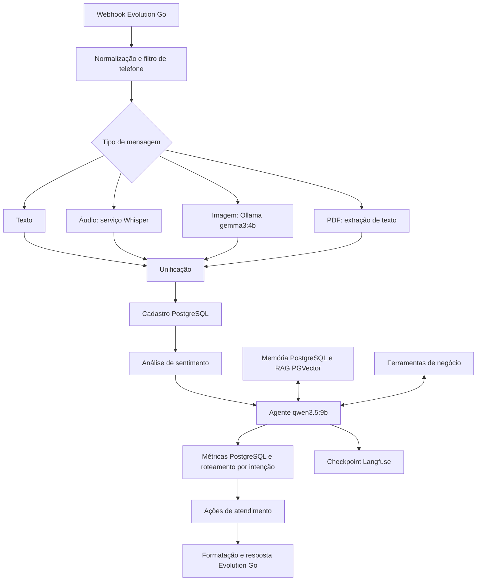

# Agente de Atendimento WhatsApp com IA e CRM

Workflow n8n para atendimento multimodal no WhatsApp, com modelos via Ollama, contexto em PostgreSQL, recuperação de conhecimento com PGVector e ferramentas de negócio.

Este repositório contém um **export sanitizado e desativado**, com 53 nós. A publicação não representa homologação funcional: não foram executados nós, workflows, APIs ou testes. Os placeholders precisam ser configurados antes do uso.

## Arquitetura

Diagrama conceitual; o JSON é a fonte das conexões efetivas. As rotas e ferramentas existentes foram preservadas, inclusive as pendências descritas abaixo.

## Ferramentas e modelos

| Componente | Uso configurado |
| --- | --- |
| n8n | Orquestração, webhook, roteamento e processamento de arquivos |
| Evolution Go | Recebimento de eventos e envio de respostas WhatsApp |
| Ollama — `gemma3:4b` | Análise de sentimento e descrição de imagens |
| Ollama — `qwen3.5:9b` | Agente de atendimento |
| Ollama — `nomic-embed-text:latest` | Embeddings para recuperação de conhecimento |
| Serviço Whisper | Transcrição de áudio por HTTP; implementação e modelo exatos não estão especificados no export |
| PostgreSQL e PGVector | Clientes, tickets, métricas, memória e base vetorial |
| HubSpot | Criação ou atualização de contatos como ferramenta do agente |
| Google Calendar, Gmail e Drive | Agendamentos, e-mails e documentos |
| Slack | Encaminhamento para equipe humana |
| Langfuse | Envio de um checkpoint OTLP por HTTP Request |

## Funcionalidades previstas

- Entrada de texto, áudio, imagem e PDF, convertidos em texto para o agente.
- Cadastro de clientes por telefone, análise de sentimento e memória de conversa.
- Consulta à base de conhecimento e aos clientes; criação de tickets.
- Ferramentas de agenda, e-mail e CRM disponíveis ao agente.
- Roteamento por intenção, registro de métricas e encaminhamento humano.
- Formatação da resposta WhatsApp e checkpoint de observabilidade.

A detecção de idioma não possui uma configuração dedicada no export, apesar do nome de um dos nós. O checkpoint Langfuse não implementa rastreamento completo de prompts, respostas, consumo ou latência do modelo.

## Configuração básica

1. Importe `agente-atendimento-whatsapp-ia-crm.json` desta pasta em uma instância n8n compatível com os tipos e versões de nós do export. Mantenha o workflow desativado até concluir a configuração e a homologação. A versão exata da instância de origem não está registrada.
2. Cadastre e vincule no gerenciador de credenciais do n8n: PostgreSQL, Ollama, HubSpot App Token, Gmail OAuth2, Google Calendar OAuth2, Google Drive OAuth2, Slack, Langfuse HTTP Basic Auth e Evolution Go Header Auth. As referências às credenciais locais foram removidas do export. Após importar, selecione as credenciais em cada nó correspondente; os blocos `credentials` não estão incluídos. Nos HTTP Requests da Evolution Go e do Langfuse, vincule respectivamente Header Auth e Basic Auth.
3. Na Evolution Go, configure o nome e o valor do cabeçalho de autenticação conforme a sua instalação na credencial **Header Auth**. O export não presume o nome desse cabeçalho. O `Content-Type` foi corrigido para `application/json`; nenhum token deve ser colocado nele.
4. Substitua os endpoints `https://*.example.invalid` pelos serviços de transcrição, Ollama, Evolution Go e Langfuse. Esses endereços são deliberadamente inválidos. Configure o endpoint do Ollama também na credencial correspondente. Use transporte protegido ou uma rede privada com proteção equivalente.
5. Configure `CONFIGURE_WHATSAPP_WEBHOOK_PATH`, os identificadores `CONFIGURE_WEBHOOK_ID` dos nós que os possuem, `CONFIGURE_ALLOWED_PHONE`, `CONFIGURE_CALENDAR_ID` e `CONFIGURE_DOCUMENT_FILE_ID`. Preserve o filtro de telefone até decidir explicitamente como operar o atendimento.
6. Prepare o PostgreSQL: tabelas `clientes`, `tickets` e `metricas_atendimento`, colunas usadas pelos nós e restrição única em `clientes.telefone` exigida pelo `ON CONFLICT`. Configure também as tabelas de memória e do PGVector. O projeto ainda não inclui migrações ou DDL; confirme nomes, permissões, extensão vetorial e dimensões compatíveis com os embeddings e com a base indexada.
7. Disponibilize os três modelos Ollama listados acima, o serviço de transcrição, as autorizações Google, o canal Slack e os acessos HubSpot. Configure as chaves pública/secreta do projeto Langfuse na credencial Basic Auth conforme a instalação utilizada.

Não há credenciais funcionais ou exemplos de dados pessoais no export publicado. Placeholders são marcadores de configuração, não valores prontos para uso.

## Pendências para a sessão de testes

As seguintes questões foram identificadas por leitura estática e **não foram alteradas para preservar a lógica original**:

- Validar o contexto de `$json.nome` e `$json.telefone` na ferramenta HubSpot; a entrada da ferramenta pode não conter esses campos.
- Revisar a rota de documentos: Gmail está conectado antes do download no Drive, embora espere o anexo `document`. A origem de `metadata.email` também precisa ser definida.
- Validar os dados disponíveis após as operações PostgreSQL e nas rotas de intenção, incluindo campos de início/fim do agendamento e resposta do agente.
- Validar formato JSON produzido pelo agente, tratamento de saídas inválidas, anexos, autenticação, permissões e contratos das integrações.
- Homologar todas as modalidades, memória, RAG, ferramentas e encaminhamento humano em ambiente controlado.
- Definir autenticação/verificação de origem do webhook: o export não configura autenticação no nó de entrada. O filtro de telefone não substitui a verificação da origem.
- Definir retenção e acesso aos dados de clientes, conversas, execuções e observabilidade antes da operação real.

## Segurança e publicação

- `pinData`, tokens, dados de conversas, todos os blocos `credentials` (IDs e nomes locais) e `meta.instanceId` foram removidos do export publicável.
- E-mails de calendário, telefone de teste, IDs privados, caminho do webhook e endpoints foram substituídos por placeholders.
- Os 53 nós e suas conexões foram preservados. As únicas mudanças de configuração funcional são a correção do `Content-Type` e a autenticação configurável da Evolution Go; as demais mudanças sanitizam valores ou documentação.
- O original operacional está em `backups/workflow-operacional-original.json`, ignorado pelo Git. A cópia operacional que estava na raiz foi preservada integralmente em `backups/workflow-operacional-preservado-2026-10-27.json`, também ignorada. Ele contém dados sensíveis: não publique, não compartilhe nem use `git add -f` nessa pasta. O backup preserva o conteúdo original, inclusive sua configuração anterior do cabeçalho.
- Rotacione o **token de instância da Evolution Go** encontrado no original, inclusive nas integrações que o utilizam. O `messageSecret` foi removido junto ao evento; ele é material criptográfico de mensagem, não uma API key a substituir no n8n. Não há evidência no export de exposição dos valores das credenciais externas HubSpot, Langfuse, PostgreSQL, Google, Slack ou Ollama; se esses valores tiverem sido compartilhados por outro meio, revogue-os também.
- O `.gitignore` não sanitiza JSONs nem remove versões já adicionadas ao índice. Antes de qualquer commit, confira que a versão em staging é a sanitizada e que o backup está ignorado.

Nenhum commit ou push é realizado como parte desta preparação.
