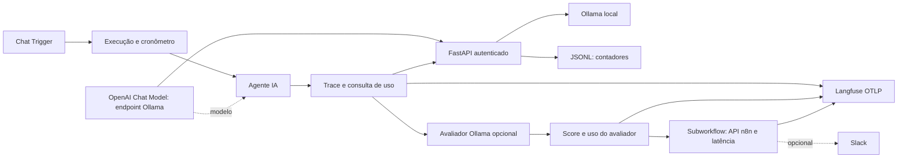

# n8n Ollama Langfuse — Observability

Laboratório de observabilidade de IA local: conversa no n8n, inferência Ollama, contadores reais capturados por FastAPI e observações enviadas por OpenTelemetry ao Langfuse. Independente de CRM, WhatsApp e bancos de projetos anteriores.

**Estado:** implementação para revisão. Consulte [validação](docs/validacao.md) antes de instalar. Uma importação válida e testes com upstream simulado não comprovam uma instalação completa Plug & Play.

## O que está incluído

- Dois workflows importáveis, sem credenciais locais ou dados de execução.
- Sessões, latência, traces e observações `generation` por requisição/modelo.
- Tokens reais separados de consumo indisponível; agregação por correlação e modelo.
- Avaliador local, score validado de 0 a 1 e justificativa com controle de privacidade.
- Monitoramento pela API n8n, sem PostgreSQL adicional; alerta Slack opcional e desabilitado.
- Proxy autenticado com SSE/NDJSON, retenção de JSONL, limites e logs de metadados.
- Instalador Windows/Linux/macOS com configuração interativa e dois modos.

## Arquitetura



O `correlation_id` combina execution ID e índice do item. Cada chamada recebe também um request ID independente no proxy. Repetições na mesma execução são agregadas; registros repetidos do mesmo request ID não são somados novamente. O avaliador usa correlação separada. Os workflows de chat foram preparados para **um item por execução**: subnós n8n resolvem expressões a partir do primeiro item. Não use este exemplo em processamento em lote sem adaptá-lo.

## Instalação rápida

Pré-requisitos: Git, Python 3.12+, Docker Engine/Desktop e Compose com `--wait`. O n8n de referência é **2.41.7**; versões anteriores não foram homologadas. O modo completo usa Langfuse 4 e seus serviços internos. Os nomes de imagem e versões estão no Compose; consulte as ressalvas de reprodutibilidade na validação.

PowerShell:

```powershell
git clone https://github.com/Denis-DBA/automacao-n8n.git
Set-Location automacao-n8n
git switch feat/n8n-ollama-langfuse-observability
Set-Location workflows/n8n-ollama-langfuse-observability
powershell -ExecutionPolicy Bypass -File scripts/setup.ps1
```

Bash:

```bash
git clone https://github.com/Denis-DBA/automacao-n8n.git
cd automacao-n8n
git switch feat/n8n-ollama-langfuse-observability
cd workflows/n8n-ollama-langfuse-observability
bash scripts/setup.sh
```

O instalador não instala programas, sobrescreve `.env` ou baixa modelos sem autorização. Para gerar somente a configuração, use `scripts/setup.ps1 -ConfigureOnly` ou `bash scripts/setup.sh --configure-only`.

1. Selecione A (infraestrutura nova) ou B (somente proxy para serviços existentes).
2. Revise portas, endereços e o nome Docker exclusivo. O padrão publica apenas em loopback.
3. Autorize a criação dos serviços novos. No modo A, o download do modelo tem confirmação separada.
4. Importe primeiro `generated/monitoramento-langfuse-ollama.json`, depois o principal.
5. Configure as [credenciais](docs/credenciais.md), selecione o subworkflow no nó `Chamar Monitoramento` e habilite esse nó.
6. No nó `Configuração da Demonstração`, confira modelo/endpoints e escolha se deseja capturar conteúdo sintético.
7. Execute o [teste demonstrativo](docs/testes.md) e confira as observações na UI Langfuse.

URLs padrão do modo A: n8n `http://localhost:15678`, Langfuse `http://localhost:13000`, proxy `http://localhost:18003`. Postgres, Redis, ClickHouse, worker e Ollama não publicam portas no host. Armazenamento de objetos usa `http://localhost:19090` em loopback para mídia Langfuse.

## Serviços existentes

Modo B cria somente `token-proxy` e seu volume, sob um nome Docker exclusivo. Não recria, reinicia ou conecta automaticamente containers existentes. Configure endereços alcançáveis **pelos containers**, não apenas pelo navegador. Leia [instalação e redes](docs/instalacao.md). No n8n existente, habilite `crypto` para Code nodes conforme sua política e configure a base URL da credencial OpenAI para o proxy, terminando em `/v1`.

## Observabilidade e limites

Traces têm observação pai `agent` e filhas `generation`. Só as filhas recebem tokens, evitando dupla contagem. `langfuse.observation.usage_details` e o nome do modelo permitem tratar uso como métrica, não apenas metadata. O dashboard deve ser conferido após a ingestão real. Não há cópia de dashboards ou preços da instalação original.

O monitor consulta a API n8n com `includeData=false`. Após cinco segundos, se a execução já terminou, mede duração do workflow; caso contrário, informa latência do agente com escopo explícito. Não volta a estimar tokens pela API n8n. Scores avaliam qualidade subjetiva e podem sofrer influência do texto avaliado.

Simple Memory serve apenas à demonstração: não oferece persistência durável, distribuição ou isolamento de sessões não autenticadas em produção. A capacidade do modelo de seguir prompts varia; nenhum desempenho ou consumo igual entre modelos é garantido.

## Segurança

O conteúdo fica **omitido no Langfuse por padrão** (`capture_content: false`). Habilite somente com dados sintéticos; sanitização por expressões regulares não garante anonimização. O n8n processa a conversa e mantém memória em RAM mesmo quando não salva execuções. Não exponha este laboratório à Internet sem autenticação de chat, TLS, proteção de rede e política de retenção.

As chaves de inferência e consulta são distintas. Nenhum header de autenticação recebido pelo proxy é enviado ao Ollama. O proxy aceita somente inferência e listagem de modelos. Um worker por instância é obrigatório; a persistência e os limites não são distribuídos. O JSONL contém IDs, modelo e contadores, com padrão de sete dias e 64 MiB; atingir o limite pode remover registros mais recentes do que sete dias. A contagem total fica indisponível quando qualquer chamada conhecida não tem uso final.

Leia [auditoria](docs/seguranca.md), [arquitetura](docs/arquitetura.md), [testes](docs/testes.md) e [troubleshooting](docs/troubleshooting.md).

## Fontes oficiais

- [Compose Langfuse](https://github.com/langfuse/langfuse/blob/main/docker-compose.yml) e [inicialização independente](https://langfuse.com/self-hosting/administration/headless-initialization).
- [OpenTelemetry e mapeamento de uso no Langfuse](https://langfuse.com/integrations/native/opentelemetry).
- [API compatível Ollama](https://docs.ollama.com/api/openai-compatibility).
- [OpenAI Chat Model no n8n](https://docs.n8n.io/integrations/builtin/cluster-nodes/sub-nodes/n8n-nodes-langchain.lmchatopenai/).

O componente n8n usa a interface OpenAI para chamar **Ollama local**, sem necessidade de conta paga OpenAI. Os componentes possuem licenças próprias; n8n é distribuído sob sua licença de uso sustentável. Este projeto não altera essas licenças.
